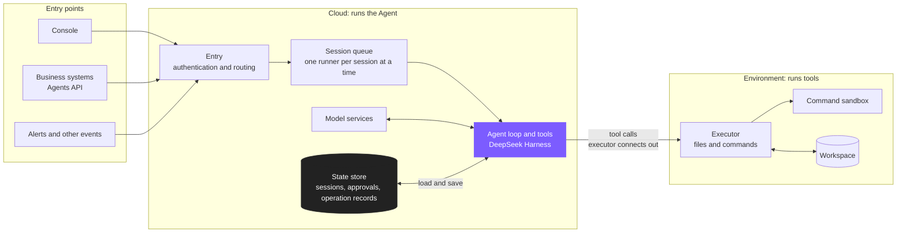
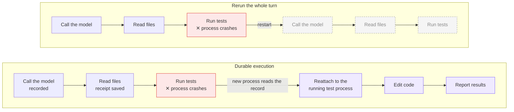

## Introduction

Much of the repetitive work in a company is a good fit for Agents: on-call triage, code fixes, data analysis, document review. If every team builds its own Agent service, the cost is high and nothing can be governed in one place. We wanted something like the [OpenAI Agents API](https://developers.openai.com/api/docs/guides/agents-api/architecture) or [Claude Managed Agents](https://platform.claude.com/docs/en/managed-agents/overview) as company infrastructure: define an Agent once, hand it to colleagues and business systems through the console or the API, and let the platform run it.

This infrastructure has to solve three problems:

- **Long-running tasks**: a task can run for hours or even days. It has to keep going through approval waits, failures and platform upgrades.
- **Controllable cost**: an idle Agent should hold no process and no container; compute is spent only while it works.
- **Easy adoption**: reuse mature open-source components wherever possible, add as little new infrastructure as possible, and plug into the company's existing permission system.

There are roughly two ways to run Agents in the cloud:

- **Agent in the sandbox**: the complete agent, including the agent loop and tools, runs inside the sandbox, and the platform schedules it from outside.
- **Loop outside the sandbox**: the agent loop runs on the server, and the sandbox only executes tools.

Both approaches work. Keeping the loop outside the sandbox has these advantages:

- **Tasks don't depend on the sandbox**: sessions and progress are kept on the server, so a sandbox can be reclaimed or rebuilt at any time and the task still carries on.
- **Compute on demand**: a sandbox is allocated only when tools need to run, and waiting for approval or input holds no resources.
- **Credentials stay on the server**: model calls and MCP calls are made from the server, so keys never enter the sandbox.
- **Unified management**: every Agent runs on the same loop, so permissions, approvals and configuration are managed in one place on the platform.

These fit our needs well: long-running tasks survive sandbox reclamation, cost is spent only while work is being done, and permissions and credentials are governed in one place. Claude Managed Agents, the OpenAI Agents API and Grok Bot take the same approach. We chose it too, and our overall architecture looks like this:

The agent loop runs in the cloud and uses tools in the execution environment. Sessions, approvals and operation records live in the cloud state store, so any process can pick up where another left off. Externally, we are compatible with the OpenAI Agents API, so business systems can integrate with the official SDKs.

In the diagram, the **Agent Harness** is the software layer that organizes how an Agent runs around the model: it manages context, calls the model, schedules tools, and applies policies such as permissions and approvals at those points. The **agent loop** is the loop inside it. We call the cloud process that runs the harness a Worker.

Our choices follow one principle: **keep state durable; start compute on demand and replace it at any time.** Sessions and workspaces are state; the processes that run the agent loop and the containers that run commands are compute. This article shares our technology choices and how we put them into practice.

## 1. An on-call scenario

Imagine an on-call Agent on the platform. One night, the error rate of the order service goes up. It's a low-priority alert that doesn't need to wake anyone:

- **02:10** The monitoring system sends the alert to the on-call Agent. The Agent queries metrics, logs and traces through MCP tools and traces the errors back to a deployment of the order service at 01:50. This turn needs no container.
- **02:16** The platform starts container A from the hosted container cluster and mounts the on-call Agent's workspace, which already holds the team's commonly used repositories, troubleshooting scripts and notes from past incidents. In the container, the Agent reads the diff of that deployment, searches the code for the failing call path, writes a test that reproduces the problem, and then edits the code.
- **02:30** While the full test suite is running, container A exits because it runs out of memory. The agent loop isn't in the container, so it is unaffected: the tool call returns "the container exited because it ran out of memory", and the platform starts container B with the same workspace. The fix and the test are still there; the Agent lowers test concurrency, reruns the suite, and the tests pass.
- **02:40** The Agent pushes a branch, opens a merge request, and offers two options: roll the order service back to its previous version through the release platform, or merge the fix. Both tools require approval. The approval request is written to the state store and the process running the Agent exits; container B is reclaimed and the workspace is kept.
- **03:00** The Agent platform performs a rolling upgrade of its Workers.
- **08:05** The on-call lead approves the rollback. An upgraded Worker takes over the session, continues from the last step, and rolls the order service back to its previous version through the release platform.
- **10:30** A reviewer asks for one more test case. The platform starts container C with the same workspace. Last night's branch, tests and notes are all still there, and the Agent picks up where it left off.

Plotted on one timeline:

```mermaid
---
config:
    gantt:
        useWidth: 900
        leftPadding: 100
        rightPadding: 110
        barHeight: 24
        barGap: 8
        fontSize: 14
        sectionFontSize: 14
---
gantt
    title The on-call Agent's night
    dateFormat HH:mm
    axisFormat %H:%M
    tickInterval 2hour
    todayMarker off
    section Session
    Alert to review :active, 02:10, 10:45
    section Workspace
    Repos and notes retained :active, 02:10, 10:45
    section Harness process
    Investigate and fix :02:10, 02:40
    Await approval (no process) :done, 02:40, 08:05
    Worker upgrade :milestone, 03:00, 0m
    Roll back and report :08:05, 08:20
    Add test :10:30, 10:45
    section Containers
    A — code and tests :02:16, 02:30
    A — out of memory :milestone, 02:30, 0m
    B — rerun tests :02:31, 02:40
    C — add test :10:30, 10:45
```

Over these eight-plus hours, three containers came and went and the harness process was replaced during the platform upgrade, yet the task never stopped. Only the session record and the files in the workspace existed the whole time. Here is what this night requires from the components, and our corresponding choices:

| What the night needs | Our choice | See |
|---|---|---|
| A container crash doesn't stop the task; native tools work as usual in a remote container; credentials never enter the container | Run the agent loop in the cloud with DeepSeek Harness, replacing where it executes and where sessions are stored | Section 2 |
| Resume from the last step after a crash or platform upgrade; hold no resources while waiting for approval; never repeat side-effecting operations | Persist the agent loop's state | Section 3 |
| Containers are created on demand; intranet machines and employee laptops can connect too | An executor that executes but never decides, reusing the execution capability of Codex exec-server | Section 4 |

## 2. The harness: a loop whose parts can be replaced in place

Our requirements for the harness were specific: keep the tools the model sees and the agent loop unchanged, while being able to replace two things: where files and commands run, and where sessions are stored. It also had to have built-in approvals, and every input sent to the model had to be reconstructable from the record. By these criteria, we compared several routes:

| Route | What you get | Our take |
|---|---|---|
| Wrap an existing agent CLI (Claude Code, Codex CLI) | All the capabilities of a mature CLI | One protocol per CLI; native approvals are hard to hand to a person; credentials and session files live in the sandbox |
| Build on an agent SDK (for example the [Claude Agent SDK](https://code.claude.com/docs/en/agent-sdk/overview)) | Hooks, permissions, MCP, sessions and other interfaces | Workable, but every extension point has to be checked for whether it can replace execution location and session storage |
| A durable harness library (for example [Pi Durable](https://github.com/earendil-works/pi/blob/d20c6e96625143bdb6fc533843d30601a9f6fcf8/packages/durable/README.md)) | Records durably before executing, and resumes after the process is interrupted | One process owns the storage at a time, so ownership across multiple Workers has to be added; the API is still experimental |
| Write our own loop | Full control | Tools, context compaction, MCP and approvals all have to be rewritten |
| [DeepSeek Harness](https://github.com/deepseek-ai/deepseek-harness) | Pluggable capability providers, event-sourced sessions, mature native tools and built-in approvals | Adopted |

The problem with wrapping a CLI centers on approvals. A CLI's approval request is a synchronous request on a running process; for a person to decide, the outer service has to keep the CLI process and the sandbox online for the whole wait. The open-source implementations we reviewed all chose to run CLIs unattended:

| Project (reviewed version) | Approval handling |
|---|---|
| Multica | Claude Code starts in [bypassPermissions mode](https://github.com/multica-ai/multica/blob/fbd3470eacc1a643f101d703875fb59a019facf7/server/pkg/agent/claude.go#L1078-L1092), and [every permission request is allowed](https://github.com/multica-ai/multica/blob/fbd3470eacc1a643f101d703875fb59a019facf7/server/pkg/agent/claude.go#L556-L598); Codex command and file-change approvals are [always accepted](https://github.com/multica-ai/multica/blob/fbd3470eacc1a643f101d703875fb59a019facf7/server/pkg/agent/codex.go#L2924-L2947) |
| OpenAgentCore | The [onboarding contract](https://github.com/MiniMax-AI/OpenAgentCore/blob/5e6c1e609c761a211f3c8053b157d38768ec2831/contracts/agents-api/harness-onboarding.md) states that a harness never asks a human: Codex uses the never approval policy with full access; when a person needs to be involved, the application supplies separate function tools |
| LobeHub (canary) | Claude Code starts in [bypassPermissions mode](https://github.com/lobehub/lobehub/blob/db7196e715c2643446adf532fe7f76efc71d2185/packages/heterogeneous-agents/src/spawn/spawnAgent.ts#L175-L192), Codex skips approvals and the sandbox by default, and TRAE permission requests [automatically pick an allow option](https://github.com/lobehub/lobehub/blob/db7196e715c2643446adf532fe7f76efc71d2185/packages/heterogeneous-agents/src/spawn/traeAcpSession.ts#L371-L381); questions can reach the user, tool permissions cannot |

These are deliberate trade-offs for unattended operation, but the rollback in our on-call scenario is exactly where someone needs to say "wait" before it runs. On top of that, the outer service has to translate a protocol for each CLI: Multica implements a separate backend for [24 CLIs](https://github.com/multica-ai/multica/blob/fbd3470eacc1a643f101d703875fb59a019facf7/server/pkg/agent/agent.go#L432-L498), and LobeHub maintains [13 drivers](https://github.com/lobehub/lobehub/tree/db7196e715c2643446adf532fe7f76efc71d2185/apps/desktop/src/main/modules/heterogeneousAgent/drivers). Model keys and MCP tokens also have to reach the CLI in the sandbox through environment variables or temporary files.

DeepSeek Harness meets our requirements:

- **Replaceable capabilities**: built on Cordis's plugin mechanism, it splits a capability into an interface, a provider and consumers. For the file tools, read, write and edit are consumers and the file system is the provider. Install a provider that points at the remote container and the tools stay unchanged; rules such as read-before-write and file version checks keep working.
- **Sessions are event logs**: every input sent to the model, every model reply and every tool call is an event in the log. The context is derived from the log, and both persistence and recovery rely on it.
- **Built-in approvals**: policies are checked before a tool runs; the cloud only has to make approvals durable.
- **One code base for local and cloud**: the same plugins run in the local harness and in the cloud platform, so fixes and new capabilities are shared.
- **A pluggable front end too**: the harness client UI is also made of plugins. We reused its conversation, tool and approval components to build the platform's cloud conversation interface as part of the platform.

So the cloud adaptation happens only at extension points: replace the providers for files, subprocesses and the sandbox; move session storage to the platform's state store; make approvals durable; add admission and budget checks before model calls; and register operations before tools run. The agent loop itself knows nothing about tenants or databases.

Running the loop in a cloud Worker has a direct benefit: the container is just where tools run. When container A ran out of memory that night, the loop saw nothing more than a failed tool call and carried on in another container. Model calls and MCP calls are also made from the cloud Worker, so the model keys and tool credentials stored by the platform never enter the container.

## 3. Persisting the agent loop's state: resume from the last step after a crash

Moving the loop to the cloud doesn't make it immune to failure: Worker processes crash, and they restart with every platform upgrade. If the loop's state lives only in process memory, then where the conversation got to, which approval it is waiting for, and which tool calls have already gone out are all lost with the process, and the whole turn has to rerun. For an Agent, rerunning a turn is expensive: model calls are paid for again, and tool calls may repeat their side effects, such as sending the rollback a second time.

The common answer in the industry is durable execution: record each step before executing it, and after a crash, let a new process read the record and continue from where things stopped. Durable execution engines such as Temporal follow this idea, and Grok Bot runs each turn as a durable workflow.

We use a similar persistence approach, built into the agent loop:

- **Every step is recorded durably**: model calls, tool calls, approvals and inputs are written to the platform's state store before the next step. Any Worker can read the record and continue from the last step.
- **Only one process advances a session at a time**: the process that takes over a session gets the right to execute; an old process that comes back to life after a pause can see what happened, but can no longer write.
- **Side-effecting operations are not blindly redone**: a tool operation is registered before it runs and leaves a receipt when it completes. Completed operations reuse their results, a command that is still running is reattached, and an operation whose outcome is unknown goes to the Agent or a person to verify.

With this in place, every key moment of that night is covered: at 02:40, once the approval is written, the process can exit and the wait holds no resources; at 08:05, an upgraded Worker takes over and continues from the last step.

## 4. The executor: executes, never decides

The loop is in the cloud, but tools have to run where the files are. In between sits an executor: it reads and writes files and runs commands in a container or on a machine, and sends the results back, but it never decides what to do next. Mechanisms like this are already common:

| Mechanism | Where the executing side runs | Relationship to the loop |
|---|---|---|
| [OpenHands action execution server](https://docs.openhands.dev/usage/architecture/runtime) | Inside the sandbox container, providing bash, a browser and more | The agent in the OpenHands backend sends actions over REST and receives observations |
| [SWE-ReX](https://swe-rex.com/latest/architecture/) | A server inside the container that hands requests to a local runtime; the container can run locally, in Docker, on Modal or on AWS | Agents such as SWE-agent call it through a remote runtime |
| [E2B envd](https://github.com/e2b-dev/infra/tree/main/packages/envd) | A daemon inside the sandbox | Applications interact with the sandbox through the SDK, for example to run commands and read and write files |
| [Daytona sandbox daemon](https://www.daytona.io/docs/en/architecture/) | Inside each sandbox, providing interfaces for files, Git, processes and terminal sessions | Applications call it through the SDK or API |
| [Claude Managed Agents environment worker](https://platform.claude.com/docs/en/managed-agents/self-hosted-sandboxes) | The user's own infrastructure, needing only outbound HTTPS | Claims sessions from a work queue, runs the tool calls sent from Anthropic's cloud locally, and posts the results back |
| [Codex exec-server](https://github.com/openai/codex/blob/654b0a77d0d2f81aa21f61caf7af4be88fe550bb/codex-rs/exec-server/README.md) | The user's computer, container or remote environment, connecting out to the platform | The OpenAI Agents API's cloud harness uses it to run file and command operations |

They share one structure: the executing side only performs actions and returns results, while the loop that decides the next step sits outside. When choosing, we cared about three things:

- **Connection direction**: the platform usually can't reach team intranets and employee laptops directly, so the executor must connect out.
- **Process management**: beyond running commands, it must read output, write input, terminate processes, and reattach to the original process after a disconnect.
- **Command sandbox**: when the executor starts a command, it must be able to apply file and network restrictions.

Codex exec-server covers all three, and it's the executor used by the OpenAI Agents API's self-hosted environments, so we reused its execution capability. To be clear, **we use only exec-server as the executor, not Codex's harness**: which file to read, which line to change and which command to run is always decided by DeepSeek Harness in the cloud Worker. On top of it, we built a launcher for our own platform, and implemented executor registration, connections, operation registration and receipt storage in the cloud.

We listed the command sandbox as a separate requirement because a container alone solves only half of the isolation problem. An execution environment actually has two layers of isolation:

| | Outer layer: container or microVM | Inner layer: command sandbox |
|---|---|---|
| What it governs | Which file system, dependencies and compute the task can use, isolated from other tasks | Which files a single command can see and write, and which networks it can reach |
| Typical implementations | Containers, microVMs | bubblewrap on Linux, Seatbelt on macOS, restricted tokens on Windows |

The executor stays resident in the outer environment and applies the inner restrictions each time it starts a command. In hosted environments the two layers stack; on an employee's laptop there is no outer container, so the inner command sandbox is the main isolation.

In hosted environments, containers are started from the cluster on demand, mount the Agent's durable workspace, and are reclaimed when idle. The same executor can also be installed in a team's own cluster or on an employee's laptop: it connects out to the platform and holds only a restricted key for its own environment, while model keys never leave the cloud.

## Conclusion

This article shared how we built our cloud Agents API. The agent loop runs in the cloud, with DeepSeek Harness replacing execution location and session storage in place. The agent loop's state is persisted, so it resumes from the last step after a crash. Execution is handed to an executor that executes but never decides, reusing exec-server's execution capability. Externally, we are compatible with the OpenAI Agents API.

In an enterprise, whether Agents actually get used depends largely on approvals and authorization: which tools can run automatically, which actions need a person's approval, which files and networks a command can touch, and who holds the credentials. With our own cloud Agents API, these questions have one place to be answered:

- **Controllable cost**: compute starts on demand, and waiting for approval or input holds no process and no container.
- **Easy operations**: processes and containers can be replaced at any time, and platform upgrades and container failures don't interrupt tasks.
- **Manageable permissions**: from an Agent's definition, sessions, model calls and tool calls down to every command in the sandbox, the whole lifecycle is under the platform's authorization.

On this foundation, our agent policy, agent gateway and sandbox authorization rules work together: the policy decides what an Agent may do, the gateway governs how model and tool calls go in and out, and the sandbox authorization rules limit what commands can reach. Each covers its own segment of the same path. That is what lets us hand work to Agents with more confidence.

## Appendix: references and projects we researched

Some of the projects below don't appear in the main text, but they were part of our research, and we list them here for reference.

### Articles and talks

- [Anthropic: Scaling Managed Agents: Decoupling the brain from the hands](https://www.anthropic.com/engineering/managed-agents): how Claude Managed Agents separates the session, the harness and the sandbox, and the problems it ran into before the split.
- [Lee Robinson: How always-on agents work](https://drive.google.com/file/d/1b8WiBk_lcB3ue-jZMLijSUMLj6SDiF6Z/view) (Stanford CS146S, [course page](https://themodernsoftware.dev/), [lecture video](https://www.youtube.com/watch?v=L1OBRtfPS34)): the server-side architecture of always-on agents, durable workflows, and computers that sleep.

### Managed Agent API platforms

- [OpenAI Agents API](https://developers.openai.com/api/docs/guides/agents-api/architecture): OpenAI's managed Agent service, where an OpenAI-hosted Codex harness runs the agent loop; the execution environment can be omitted, hosted, or a [self-hosted exec-server](https://developers.openai.com/api/docs/guides/agents-api/environments/self-hosted). Our external interface is compatible with it.
- [Claude Managed Agents](https://platform.claude.com/docs/en/managed-agents/overview): Anthropic's managed agent harness and infrastructure, where the session, harness and sandbox are independent of each other; [self-hosted sandboxes](https://platform.claude.com/docs/en/managed-agents/self-hosted-sandboxes) use an environment worker that claims work and runs tool calls locally.
- [Qoder Cloud Agents](https://docs.qoder.com/cloud-agents/overview): a fully managed agent runtime platform where each session runs in an isolated container sandbox; self-hosted environments claim tasks through a work queue and worker leases, and a separate Forward mode delivers Agents to end users.

### Always-on Agent products

- [Grok Bot](https://x.ai/news/introducing-grok-bot): xAI's always-on Agent teammate. According to the lecture above, the agent loop runs on the server and durable execution is built on Temporal; each user's Linux computer runs in a Firecracker virtual machine that is snapshotted and put to sleep when idle.

### Agent platforms and runtimes

- [OpenAgentCore](https://github.com/MiniMax-AI/OpenAgentCore/blob/5e6c1e609c761a211f3c8053b157d38768ec2831/docs/architecture.md): MiniMax's open-source platform that targets the OpenAI Agents API and runs native harnesses from Codex, Claude Code or MiniMax in the execution environment.
- [Tetral](https://github.com/tetral-ai/tetral/blob/01e06cbd1fda22c05a3410fbbd3f207b18f06085/README.md): an open-source cloud agent platform compatible with Anthropic's managed API; it runs its own ThreadLoop in Kubernetes, with sandboxes provided by a separate service (the researched version uses a Daytona driver).
- [CubePlex](https://github.com/cubeplexai/cubeplex/blob/0d5ac88dad18928fe18c09b2168d06ea52b9d3a8/backend/docs/agent-system-design.md): an agent product for team workspaces; its backend runs CubeLoop and reaches remote containers through an OpenSandbox driver.
- [OpenHands](https://docs.openhands.dev/usage/architecture/runtime): an open-source coding agent platform where the agent runs in the backend and an action execution server in the sandbox container executes actions.

### Team collaboration and task platforms

- [Multica](https://github.com/multica-ai/multica/blob/fbd3470eacc1a643f101d703875fb59a019facf7/apps/docs/content/docs/developers/architecture.mdx): organizes team collaboration around issues and runs; a daemon on members' machines invokes installed agent CLIs, with backends for 24 CLIs in the reviewed version.
- [LobeHub](https://github.com/lobehub/lobehub/blob/db7196e715c2643446adf532fe7f76efc71d2185/README.md): an Agent team and operations platform; its native path is driven by the server, and its heterogeneous path runs Claude Code or Codex in a cloud sandbox.

### Harnesses and SDKs

- [DeepSeek Harness](https://github.com/deepseek-ai/deepseek-harness) and [Cordis](https://github.com/cordiverse/cordis): the harness we adopted and its plugin framework, which separates capability interfaces, providers and consumers and makes the front end pluggable too.
- [Claude Agent SDK](https://code.claude.com/docs/en/agent-sdk/overview): an SDK for building agents with Claude Code's capabilities, offering hooks, permissions, MCP, sessions and other extension points.
- [Pi Durable](https://github.com/earendil-works/pi/blob/d20c6e96625143bdb6fc533843d30601a9f6fcf8/packages/durable/README.md) and [pi-env](https://github.com/earendil-works/pi/blob/d20c6e96625143bdb6fc533843d30601a9f6fcf8/packages/env/README.md): a durable harness library that writes sessions, tasks and application state atomically in one commit; pi-env runs tools on another machine over SSH. The researched version is still experimental.

### Execution and sandbox infrastructure

- [Codex exec-server](https://github.com/openai/codex/blob/654b0a77d0d2f81aa21f61caf7af4be88fe550bb/codex-rs/exec-server/README.md): OpenAI's open-source execution service, providing execution sessions, file and process operations, remote registration and command sandboxing; we reuse it as our executor.
- [E2B](https://docs.e2b.dev/): cloud sandbox infrastructure where the [envd](https://github.com/e2b-dev/infra/tree/main/packages/envd) daemon inside the sandbox handles interaction with the SDK.
- [Daytona](https://www.daytona.io/docs/en/architecture/): sandbox infrastructure where a daemon inside each sandbox provides the Toolbox API for files, Git, processes and terminal sessions.
- [OpenSandbox](https://github.com/opensandbox-group/OpenSandbox): open-source sandbox infrastructure that provides remote execution and sandbox lifecycle management.
- [SWE-ReX](https://swe-rex.com/latest/architecture/): the SWE-agent team's remote execution framework, where a server inside the container runs commands; the container can run locally, in Docker, on Modal or on AWS.

### Durable execution

- [Temporal](https://docs.temporal.io/): an open-source durable execution engine where each workflow step is recorded, so work resumes from where it stopped after a crash.
